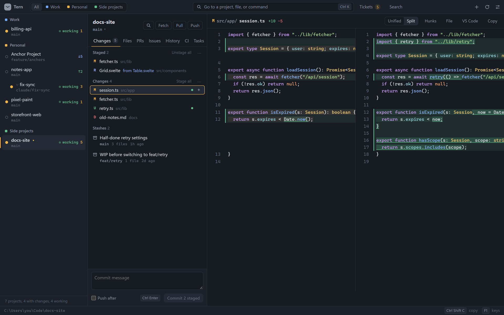
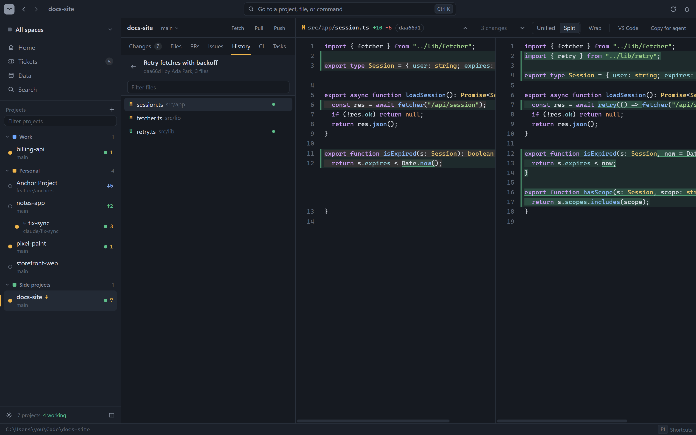
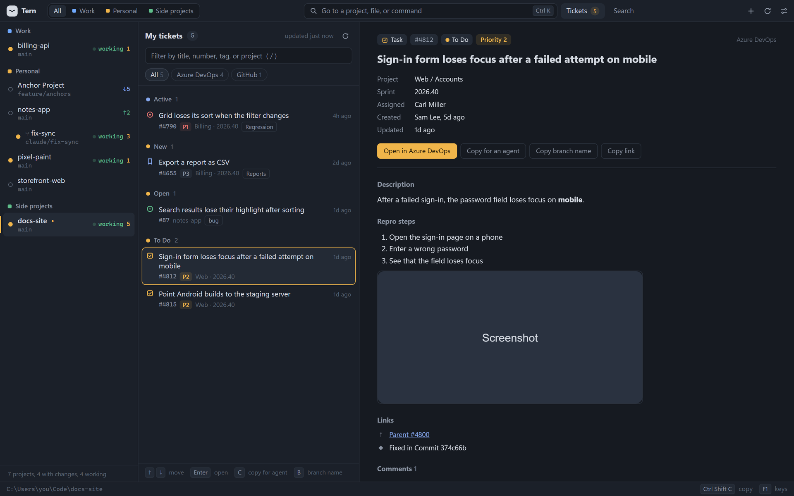
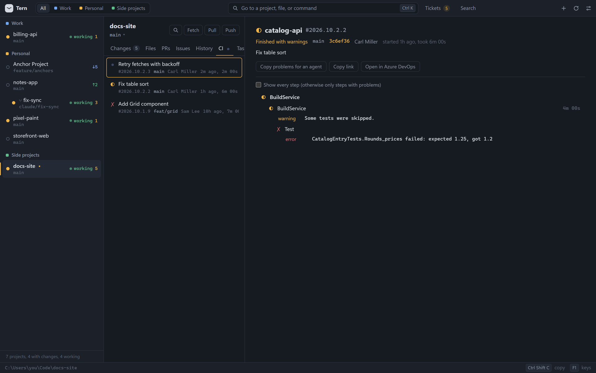
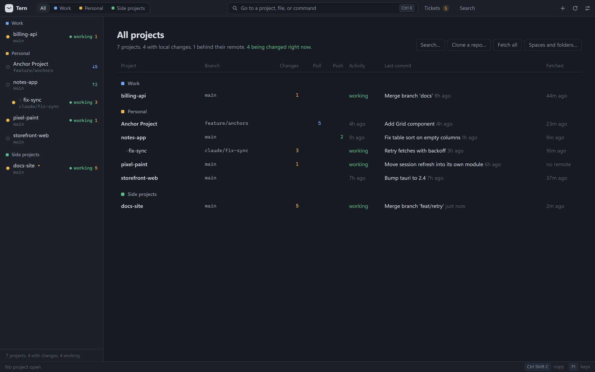

<p align="center">
  
</p>

<h1 align="center">Tern</h1>

<p align="center">
  A fast, keyboard-first app for reviewing many git repos at once.<br>
  Built for working alongside coding agents.
</p>

<p align="center">
  <a href="https://car-role.github.io/tern/">Website</a> ·
  <a href="https://github.com/Car-Role/tern/releases/latest">Download</a> ·
  <a href="docs/guide.md">Guide</a>
</p>

<p align="center">
  <a href="https://github.com/Car-Role/tern/releases/latest"></a>
  <a href="https://github.com/Car-Role/tern/actions/workflows/check.yml"></a>
  <a href="LICENSE"></a>
</p>



## Why Tern

When agents write the code, your job moves from typing to reviewing. You watch many repos and worktrees,
read diffs, check CI, pull and push, and hand exact file paths back to the agent.

Code editors are built for writing. Tern is built for that review loop: one window over every repo, and
every action one keystroke away. It starts in under a second and stays out of your way.

## What it does

- **Every repo at a glance.** Tern finds the git repos under your folders and shows each one's branch,
  changed files, and commits to pull or push. Worktrees that agents create fold under their repo.
- **Agent activity.** A repo shows *working* while its files keep changing, and Tern tells you when it goes quiet.
- **Review.** Split or unified diffs, a commit graph, and a branch review that shows everything a branch
  did since it left `main`. Commits on the remote that you don't have yet show above your branch.
- **Hand off to agents.** Copy paths as relative, absolute, `path:line`, or `@mentions`, or copy a diff,
  a failing CI run, or a ticket as plain text for an agent.
- **Git without the ceremony.** Stage, commit, stash, discard, fetch, pull, and push. Discards can be undone,
  pull and push always show what will happen first, and an unpushed commit can be taken back.
  Branches and worktrees are one shortcut away.
- **Pull requests, issues, CI, and tickets.** From GitHub (through `gh`) and Azure DevOps (through `az`),
  in the same views.
- **Tasks and terminals.** Tern finds your npm scripts, VS Code tasks, .NET, Cargo, Gradle, Make, and
  Docker Compose tasks. Tasks and terminals run on real pseudo-terminals, so prompts and full-screen tools work.
- **Search everything.** Code, file names, commits, branches, PRs, and issues, in one repo, a space, or all repos.
- **Spaces and themes.** Group repos into spaces like Work and Personal. Twelve themes, dark and light, or follow your system.

See the [guide](docs/guide.md) for every feature and shortcut.

<table>
  <tr>
    <td></td>
    <td></td>
  </tr>
  <tr>
    <td></td>
    <td></td>
  </tr>
</table>

## Install

Download the file for your system from the [latest release](https://github.com/Car-Role/tern/releases/latest).

| System | File |
| --- | --- |
| Windows (most PCs) | `Tern_<version>_x64-setup.exe`, or the `.msi` |
| Windows on ARM | `Tern_<version>_arm64-setup.exe` |
| macOS, Apple Silicon (M1 and later) | `Tern_<version>_aarch64.dmg` |
| macOS, Intel | `Tern_<version>_x64.dmg` |
| Linux x64 | `.AppImage`, `.deb` (Debian, Ubuntu), or `.rpm` (Fedora, openSUSE) |
| Linux ARM64 | The same three formats, marked `arm64` or `aarch64` |

The builds are not code-signed yet, so the first launch needs one extra step:

- **Windows:** if SmartScreen says "Windows protected your PC", click **More info**, then **Run anyway**.
- **macOS:** open the app once with right-click, then **Open**. Or run `xattr -dr com.apple.quarantine /Applications/Tern.app`.
- **Linux AppImage:** make it runnable with `chmod +x Tern_*.AppImage`.

### What Tern needs

- **git** on your `PATH`.
- **Optional:** [GitHub CLI](https://cli.github.com/) (`gh`) for GitHub pull requests, issues, and Actions,
  and [Azure CLI](https://learn.microsoft.com/cli/azure/) (`az`) with the `azure-devops` extension for Azure DevOps.
  Tern uses their existing sign-ins and never stores a token of its own.
- **Linux:** WebKitGTK 4.1 (installed with most desktops).

### Open Markdown files with Tern

Tern can open `.md`, `.markdown`, and `.mdx` files as a rendered page. To make it the default on Windows,
right-click a `.md` file, choose **Open with**, then **Choose another app**, pick **Tern**, and click **Always**.

## Keyboard

| Keys | Action |
| --- | --- |
| `Ctrl K` / `Ctrl P` / `Ctrl Shift P` | Go to a project / a file / a command |
| `Ctrl Shift F` / `Ctrl F` | Search everywhere / search this file |
| `↑` `↓` or `J` `K` | Move through the list; changes open as you move |
| `Ctrl Shift C`, then `R` `A` `L` `M` `D` | Copy a relative or absolute path, path with lines, `@mention`, or diff |
| `S`, then `Ctrl Enter` | Stage, then commit |
| `Ctrl D` | Split or unified diff |
| `Ctrl B` | Branches and worktrees |
| `Ctrl Shift T` | Your tickets |
| `` Ctrl ` `` / `Ctrl J` | Terminal / bottom panel |
| `F12` / `Shift F12` | Go to definition / find where it is used |
| `F1` | All shortcuts |

## Build from source

You need [Node.js](https://nodejs.org/) 20 or newer, [Rust](https://rustup.rs/), and the
[Tauri prerequisites](https://v2.tauri.app/start/prerequisites/) for your system.

```bash
npm install
npm run app        # a development window with live reload
npm run dev        # the screen only, in a normal browser, with sample data
npm run release    # an installer for this system, in src-tauri/target/release/bundle
npm run test:rust  # back-end tests
npm run check      # type check
```

On Windows, the scripts load the Visual Studio Build Tools C++ setup first when it is installed
([scripts/msvc.cmd](scripts/msvc.cmd)).

### Releases

The [Build workflow](.github/workflows/build.yml) builds every installer above on GitHub's machines.
Push a version tag to make a draft release with all of them attached:

```bash
git tag v0.2.0
git push origin v0.2.0
```

Check the draft on the Releases page, then publish it. Keep the version in
[`src-tauri/tauri.conf.json`](src-tauri/tauri.conf.json) and `package.json` in step with the tag.

## How it is built

Tauri 2 with a Rust back end and the system web view, and a Svelte 5 and CodeMirror 6 front end.
The installer is about 2 MB.

The rules that keep it fast:

- Start in under a second. File lists, pull requests, and history load only when you open their tab.
- Run git with `GIT_OPTIONAL_LOCKS=0`, so Tern never blocks an agent using the same repo.
- Keep all settings in one JSON file (Settings shows where).
- No plugins, language servers, project-wide indexing, accounts, or cloud sync.
  Sign-in stays with `gh` and `az`.

## License

Tern is source-available under the [Business Source License 1.1](LICENSE). In short:

- **Free** for individuals, and for organizations with fewer than 100 people and under US $1M in yearly revenue,
  including their people using it at work.
- **Larger organizations** can try it for 30 days, then need a commercial license.
- **Not allowed:** using Tern, or a changed version of it, to build or sell a competing product or service.
- **Each version becomes open source** under the Apache License 2.0 four years after its release.

For a commercial license, [open an issue](https://github.com/Car-Role/tern/issues/new?title=Commercial%20license) titled "Commercial license".
The [LICENSE](LICENSE) file is the legal text; this summary does not replace it.
